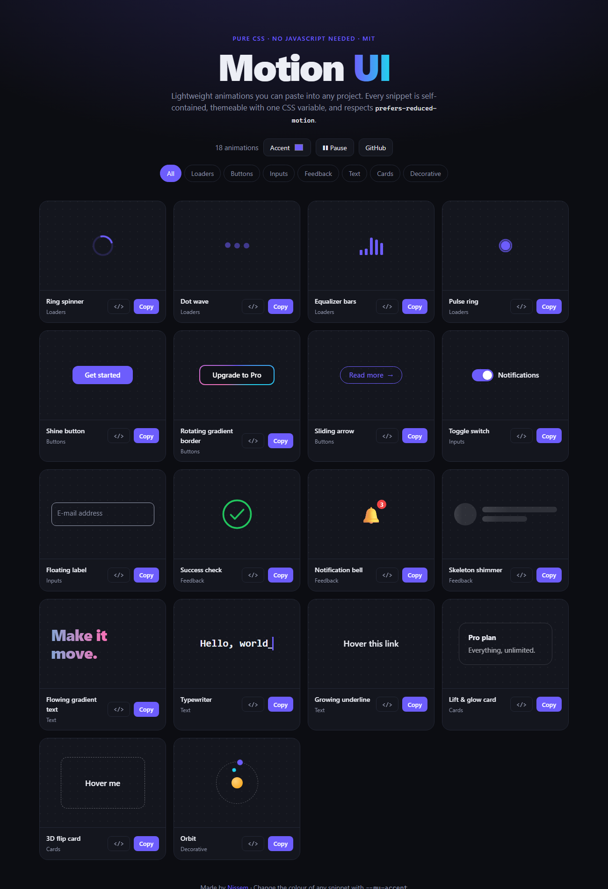

# Motion UI

[](https://github.com/NissemBatMan/motion-ui/actions/workflows/ci.yml)


**18 lightweight, accessible, pure-CSS animations you can copy into any project.**
Loaders, buttons, inputs, feedback, text effects and cards: one click copies the HTML + CSS.

### ▶ [Open the gallery](https://nissembatman.github.io/motion-ui/)



## Why

- **Pure CSS.** The snippets need no JavaScript and no library.
- **Self-contained.** Every class, `@keyframes` and custom property is prefixed with the snippet's name, so nothing clashes with your styles. A test enforces it.
- **Themeable.** Set `--mu-accent` once and every snippet follows your brand colour.
- **Accessible.** Each snippet ships a `prefers-reduced-motion` rule; loaders have `role="status"` and a label; interactive demos work with the keyboard.
- **Small.** Each snippet is a few hundred bytes.

## Animations

| Category | Snippets |
| --- | --- |
| Loaders | Ring spinner · Dot wave · Equalizer bars · Pulse ring |
| Buttons | Shine button · Rotating gradient border · Sliding arrow |
| Inputs | Toggle switch · Floating label |
| Feedback | Success check · Notification bell · Skeleton shimmer |
| Text | Flowing gradient text · Typewriter · Growing underline |
| Cards | Lift & glow card · 3D flip card |
| Decorative | Orbit |

## Use a snippet

1. Open the [gallery](https://nissembatman.github.io/motion-ui/) and click **Copy** (or `</>` to read the code).
2. Paste the HTML where you want it and the CSS in your stylesheet.
3. Optional: change the colour.

```css
:root {
  --mu-accent: #0ea5e9;
}
```

Deep links open a snippet directly: `https://nissembatman.github.io/motion-ui/#typewriter`.

## Add an animation

Every animation is one object in [`src/animations.js`](src/animations.js):

```js
{
  id: "my-effect",          // every class / keyframes name must start with this
  title: "My effect",
  category: "Buttons",
  html: `<button class="my-effect">Click</button>`,
  css: `.my-effect { ... } @keyframes my-effect-move { ... }`,
}
```

Then run the checks (Node 20+, no install needed):

```bash
npm test   # unique ids, prefixes, keyframes exist, balanced braces, accessibility
```

## Run locally

Any static server works, for example:

```bash
npx http-server .
```

## License

MIT © Nissem
